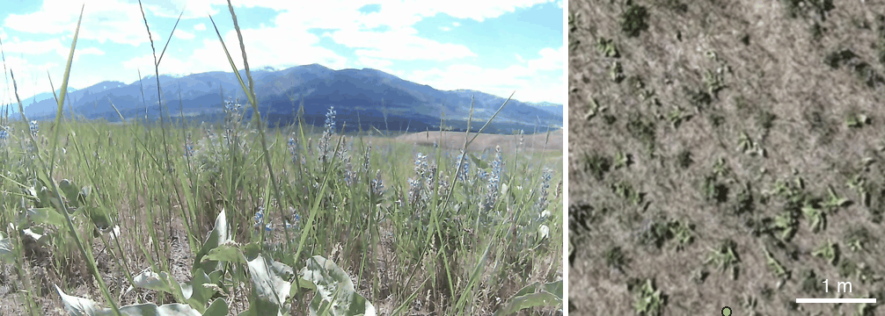

<p align="center">
  
</p>

# MPG Ranch Multimodal Survey

[](https://huggingface.co/datasets/mpg-ranch/multimodal-survey)
[](https://creativecommons.org/licenses/by/4.0/)
[](LICENSE)

A quadruped robot walked fixed routes through a grassland under restoration at
MPG Ranch, Montana, and photographed the vegetation every meter. A drone mapped
the same ground within a day of each walk. This repository contains the field records of
those surveys, the pipeline that turns them into a dataset of paired ground and
drone images, and the baseline experiments reported with the dataset.

<p align="center">
  
</p>
<p align="center">
  <sub>Thirty five consecutive capture positions along one leg. The ground image is on the left. Its paired 4 by 4 m drone image is on the right, rotated so the robot's bearing points up, with the antenna position in yellow and a 1 m scale bar.</sub>
</p>

## The dataset

The dataset is
[`mpg-ranch/multimodal-survey`](https://huggingface.co/datasets/mpg-ranch/multimodal-survey)
on Hugging Face, under CC BY 4.0. Each row pairs one ground image with the
drone image of the 4 by 4 m of ground ahead of the robot, and records which of
eight plant species are present in the ground image.

```python
from datasets import load_dataset

ds = load_dataset("mpg-ranch/multimodal-survey")
```

| | |
|---|---|
| Ground images | 8,287, each 1280 by 720 pixels |
| Drone images | One per ground image, 4 by 4 m at 1.30 cm per pixel, 308 by 308 pixels |
| Labels | Presence of eight species, four seeded natives and four invasive weeds, and an image quality level |
| Extent | Two sites and nine strips, each surveyed in two capture events, over four days in June 2026 |
| Splits | 6,480 training, 1,613 test, 194 tier 2 |
| Columns | 33 |

The dataset card describes every column, the splits, and recipes for loading
and filtering. Its source is
[`multimodal_dataset/card/README.md`](multimodal_dataset/card/README.md).

## How to cite

A data descriptor is in preparation. Until it is published, please cite the
dataset.

> Doherty, K. et al. MPG Ranch Multimodal Survey: paired ground-robot and drone imagery of Montana grassland. Hugging Face (2026). https://huggingface.co/datasets/mpg-ranch/multimodal-survey

The "Cite this repository" button in the sidebar gives the same reference in
BibTeX and APA form, from [`CITATION.cff`](CITATION.cff). A DOI will be added
when the dataset is released.

## What is in this repository

```
multimodal_survey/
├── missions/              survey definitions and everything the robot recorded
│   ├── <site>/<strip>/    one folder per strip (configuration, runs, labels)
│   ├── inventory.csv      status of the runs
│   └── planning/          QGIS project and basemap used to lay out the strips
├── multimodal_dataset/    the pipeline that builds, verifies and uploads the dataset
├── modeling/              the baseline experiments
└── dev/                   three early test runs of one strip
```

### Use the dataset

Load it from Hugging Face as shown above. The
[dataset card](multimodal_dataset/card/README.md) explains the columns, the
splits, filtering by image quality, and how to re-crop the drone image.

### Rebuild the dataset

`multimodal_dataset/` reads every completed run in `missions/`, crops each
drone image from its flight's orthomosaic, assigns the splits, and checks every
published number before an upload.

```bash
pip install -r multimodal_dataset/requirements.txt
python -m multimodal_dataset build     # missions/ and the orthomosaics to multimodal_dataset/out/
python -m multimodal_dataset verify    # every release check must pass before an upload
python -m multimodal_dataset push      # upload to Hugging Face with the card
```

Pushing needs a Hugging Face write token in `.env` (`HF_TOKEN=...`). Build and
verify need no credentials. The same folder contains the app that produced the
species and quality labels, described in
[`multimodal_dataset/labeling/README.md`](multimodal_dataset/labeling/README.md).
Labeling is complete, and the app remains as a record of how the labels were
made.

### Reproduce the baselines

`modeling/` contains the code and the results of the baseline classifiers
reported with the dataset. One classifier reads the ground image and one reads
the drone image, each a linear layer on a frozen DINOv3 model, and a late
fusion combines the two. The [README of that folder](modeling/README.md) lists
the steps. Feature extraction and training need a CUDA GPU, and the scores can
be recomputed from the tracked predictions without one.

| Modality | Macro AP, cross-validation [95% CI] | Macro AP, test split |
|---|---|---|
| Drone image | 0.457 [0.407, 0.497] | 0.373 |
| Ground image | 0.809 [0.775, 0.834] | 0.809 |
| Fused | 0.812 [0.776, 0.841] | 0.815 |

### How the data were collected

A Unitree Go2 robot walked each strip under
[go2-survey](https://github.com/mosscoder/mpg-ai-edge), the mission software,
which lives in its own repository. Each strip has a folder
`missions/<site>/<strip>/` with the following contents.

- `mission.toml`, the run configuration (leg geometry, capture interval, steering)
- `seed_poly.geojson`, the boundary of the strip, drawn in QGIS
- `waypoints.geojson`, the leg corners generated from that boundary
- `mission_layout.png`, a preview of the route
- `runs/<run_id>/`, one folder per walk of the strip, with the ground images and
  a JSON sidecar for each in `captures/`, the field logs, and the labels in
  `labels/species.json` and `labels/quality.json`

`missions/inventory.csv` tracks the status of the runs, and
`missions/planning/` contains the QGIS project used to lay out the strips. The
operator procedure for a survey is the
[field walkthrough](https://github.com/mosscoder/mpg-ai-edge/blob/refactor/docs/field-walkthrough.md)
in the go2-survey repository.

## Status

The field campaign, the labeling and the dataset build are complete. The
dataset is private while the data descriptor is in preparation. It will become
public, with a DOI, when the descriptor is submitted. A multispectral drone image is planned as a
follow-up column.

## License

Code in this repository is MIT licensed (see [`LICENSE`](LICENSE)). The dataset
is released under CC BY 4.0.
