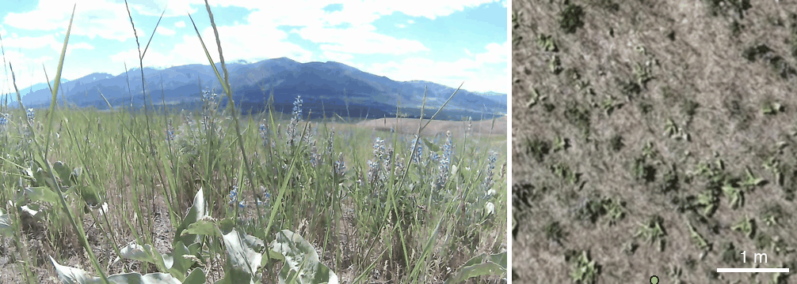
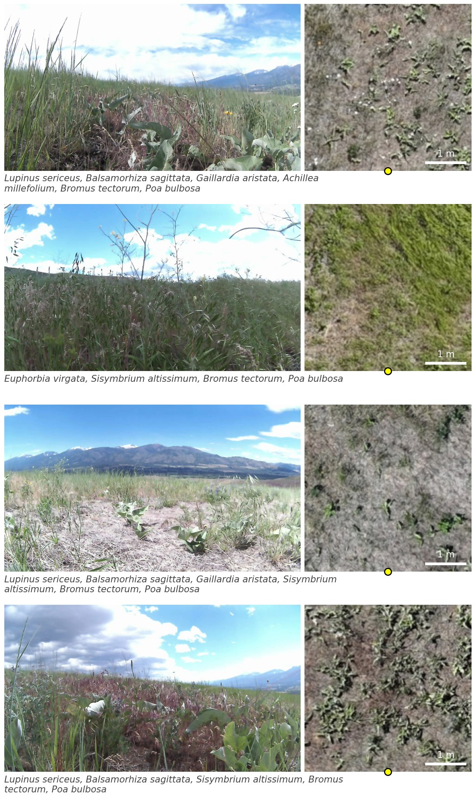

# MPG Ranch Multimodal Survey

Monitoring vegetation change at the landscape scale is costly in wildland
settings due to factors such as rugged terrain and rarity of botanical
expertise. We release a dataset of paired ground robot and aerial drone imagery
to enable the study of the relative benefit of each platform for automated
vegetation monitoring at fine spatial scales. A Unitree Go2 quadruped robot
walked fixed routes through a grassland in Montana, USA, photographing the
ground ahead every meter, and a DJI Mavic 3M drone photographed the same ground
from above. Both platforms were RTK-enabled and covered every route twice,
capturing the same scenes under different lighting. Each of the 8,287 ground
images is paired with a 4 by 4 m drone image cropped from a 1.30 cm per pixel
orthomosaic at the robot's position. A botanist labeled every ground image for
eight target species, four natives and four invasive weeds. We established
baseline classifier performance with DINOv3 vision encoders, achieving a macro
average precision on the test split of 0.809 (ground), 0.373 (drone), and 0.815
(fusion, a weighted average of both predictions). We hope that others may use
our dataset to advance methods for automating vegetation surveys.



A sequence of capture positions along one leg of the Go2 survey. The ground image is on the left. Its paired 4 by 4 m drone image is on the right, rotated so the robot's bearing points up.

## Paired examples

The left column shows the ground image, with the species present listed
beneath it. The right column shows the drone image for the same row, rotated
so the robot's bearing points up, with the antenna at the bottom-edge midpoint
(yellow) and a white bar spanning 1 m.



## Columns

Each of the 8,287 rows is one ground image and its paired drone image, described by 33 columns.

| Column | Type | Description |
|---|---|---|
| `frame_id` | string | Unique identifier, the file name stem of the ground image |
| `ground_image` | Image | The ground image, a 1280 by 720 JPEG |
| `drone_image` | Image | The drone image, 4 by 4 m at 1.30 cm per pixel, 308 by 308 pixels, with the robot's antenna at the middle of the bottom edge and its bearing pointing up |
| `species` | Sequence(ClassLabel) | Class indices of the target species present, as labeled by a botanist, empty when none are present. Names are in [`species.csv`](species.csv) |
| `artifact_level` | ClassLabel(4) | Quality level 0 to 3 from a second annotator, by the quarter of the ground image degraded by video decoder artifacts |
| `site` | string | `site_1` or `site_2` |
| `strip` | string | `strip_1` to `strip_5` within the site |
| `latitude` | float64 | WGS84 latitude of the robot's GNSS antenna at the shutter instant |
| `longitude` | float64 | WGS84 longitude of the antenna |
| `altitude_ellipsoidal_m` | float64 | Ellipsoidal height of the antenna |
| `accuracy_horizontal_m` | float64 | Receiver-reported horizontal accuracy, 1.4 to 1.7 cm |
| `accuracy_vertical_m` | float64 | Receiver-reported vertical accuracy, 1.0 to 1.7 cm |
| `fix_type` | int8 | RTK solution, 6 (fixed) on 8,285 ground images and 5 (float) on 2 |
| `pdop` | float64 | Position dilution of precision |
| `satellites_used` | int8 | Satellites in the solution |
| `bearing_deg` | float64 | Bearing of the robot in degrees clockwise from true north |
| `footprint_wkt` | string | The 4 by 4 m footprint of the drone image as a WGS84 polygon |
| `ground_captured_at` | string | Shutter instant of the ground image, ISO 8601 |
| `drone_captured_at` | string | Median capture time of the matched drone flight |
| `capture_offset_absolute` | float64 | Hours from the flight's median capture to the ground image, median 1.16 and at most 20.29 |
| `capture_offset_time_of_day` | float64 | The same offset by time of day alone |
| `capture_event` | int8 | First or second capture event of the strip, 1 or 2 |
| `mission_restart_utc` | string, nullable | Resume time of the one interrupted run, set only on the 31 ground images captured after it |
| `pair_frame_id` | string, nullable | `frame_id` of the ground image at the same planned position in the strip's other capture event, null for the 153 without one |
| `pair_distance_m` | float64, nullable | Distance between the two paired antenna positions, median 0.10 m |
| `pair_overlap_fraction` | float64, nullable | Fraction of the footprint covered by the paired row's footprint |
| `pair_offset_hours` | float64, nullable | Hours between the two paired ground images |
| `leg` | string | `leg01` to `leg13`, odd numbers for the straight lines of a strip and even numbers for the turns between them |
| `along_leg_m` | float64 | Nominal distance along the leg, 0 to 150 m |
| `frame_offset_s` | float64 | Shutter instant relative to reaching the planned position |
| `speed_mps` | float64 | Robot speed at the shutter |
| `run_id` | string | The robot run, one per strip and capture event |
| `tier2_overlap_fraction` | float64, nullable | Fraction of the footprint covered by test footprints, `train_tier_2` rows only |

## How to load

### Basics

```python
# pip install datasets
from datasets import load_dataset

# the clean training split: 6,480 ground images, zero test overlap in the drone images
train = load_dataset("mpg-ranch/multimodal-survey", split="train")
test  = load_dataset("mpg-ranch/multimodal-survey", split="test")

row = train[69]
row["ground_image"]  # PIL.Image, 1280x720: the ground image
row["drone_image"]   # PIL.Image, 308x308: the 4 m nadir drone image, bearing up
row["species"]       # [0, 7]  (class ids, see the multi-hot snippet below)
row["artifact_level"]# 0  (level 0: 0-25% of the ground image degraded)
```

The dataset has three splits. `test` (1,613 rows) is the outermost leg of
every strip. `train` (6,480 rows) is the rest, apart from the 194 rows of
`train_tier_2`, whose drone image overlaps a test drone image. Leave tier 2
out for a training split that has no ground in common with the test split in
the drone images, or add it for more training data.

### Species labels to a multi-hot vector

```python
import numpy as np

CLASSES = train.features["species"].feature.names   # canonical order, 8 classes

def multi_hot(batch):
    v = np.zeros((len(batch["species"]), len(CLASSES)), dtype=np.int8)
    for i, ids in enumerate(batch["species"]):
        v[i, ids] = 1                               # species are stored as class ids
    return {"labels": v}

train = train.map(multi_hot, batched=True)
```

### Filtering

```python
# drop the heavily degraded ground images (level 3)
LEVELS = train.features["artifact_level"].names
clean = train.filter(lambda r: r["artifact_level"] != LEVELS.index("75-100%"))

# ground images captured close in time to their drone imagery
tight = train.filter(lambda r: abs(r["capture_offset_time_of_day"]) < 1.0)

# one site, one capture event
morning = train.filter(lambda r: r["site"] == "site_2" and r["capture_event"] == 1)

# rows where a particular species is present
spurge = train.filter(lambda r: CLASSES.index("Euphorbia virgata") in r["species"])
```

### Including tier 2

```python
# drone images that overlap the test split
t2 = load_dataset("mpg-ranch/multimodal-survey", split="train_tier_2")

# or only the mildly-overlapping ones, e.g. under 10% of the drone image shared
t2_mild = t2.filter(lambda r: r["tier2_overlap_fraction"] < 0.10)

from datasets import concatenate_datasets
train_plus = concatenate_datasets([train, t2_mild])
```

### Building a paired dataloader

```python
import torch
from torchvision.transforms.functional import to_tensor

def collate(batch):
    # the ground image is oblique and wide-angle. The drone image is nadir and metric.
    # They cover overlapping ground but are NOT pixel-registered to each other.
    robot = torch.stack([to_tensor(b["ground_image"].resize((640, 360))) for b in batch])
    drone = torch.stack([to_tensor(b["drone_image"]) for b in batch])   # 3x308x308
    y     = torch.tensor(np.stack([b["labels"] for b in batch]), dtype=torch.float32)
    return robot, drone, y

loader = torch.utils.data.DataLoader(train, batch_size=32, collate_fn=collate)
```

### Re-cropping the drone image

```python
# the drone image is a metric chart: rows are meters ahead of the antenna, columns meters left.
# A smaller or shifted window is array slicing. No projection knowledge is needed.
N, P = 308, 0.0130                              # pixels per side, meters per pixel
PX = 1 / P                                      # 76.9 px per meter

def sub_crop(drone_image, ahead, left, size):
    # (ahead, left): window center in meters from the antenna
    a = np.asarray(drone_image)
    r = round(N - (ahead + size / 2) * PX)      # row 0 is 4.004 m ahead
    c = round(N / 2 - (left + size / 2) * PX)   # column 0 is 2.002 m left
    return a[r : r + round(size * PX), c : c + round(size * PX)]

patch = sub_crop(row["drone_image"], ahead=1.0, left=0.0, size=2.0)  # 2 x 2 m, 154 x 154 px
```

### Recovering the drone image geometry

```python
# each drone image spans 0 to 4.004 m ahead of the antenna and 2.002 m to either side,
# rotated so `bearing_deg` points up the image. To place a drone image pixel on the ground:
import math

def pixel_to_ground(row, px, py, P=0.0130, N=308):
    th = math.radians(row["bearing_deg"])
    fwd = (N - py - 0.5) * P                 # meters ahead of the antenna
    lat = (N / 2 - px - 0.5) * P             # meters to the left
    dE  = fwd * math.sin(th) - lat * math.cos(th)
    dN  = fwd * math.cos(th) + lat * math.sin(th)
    return dE, dN                            # offset in meters, EPSG:6514
```

## GitHub project

The [multimodal_survey](https://github.com/mosscoder/multimodal_survey)
repository on GitHub contains the records of the field surveys, the pipeline
that built this dataset, and the baseline experiments, with their code and
results in
[`modeling/`](https://github.com/mosscoder/multimodal_survey/tree/main/modeling).
The robot ran [go2-survey](https://github.com/mosscoder/go2-survey), the
mission software, which has its own repository. The code in both is under the
MIT license.

## How to cite

A data descriptor is in preparation. Until it is published, please cite the
dataset.

> Doherty, K., Stam, N., Salakhutdinov, P., Samsoe, E. & Casper, C. MPG Ranch Multimodal Survey: paired ground-robot and drone imagery of Montana grassland. Hugging Face (2026). https://huggingface.co/datasets/mpg-ranch/multimodal-survey

[`CITATION.cff`](CITATION.cff) gives the same reference in machine-readable
form. The data are released under CC BY 4.0, and this release was built from
commit `SOURCE_COMMIT` of the GitHub project.
