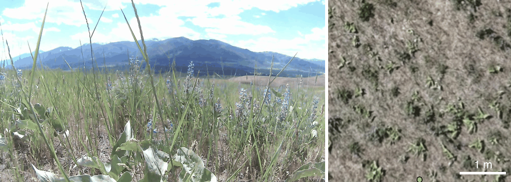
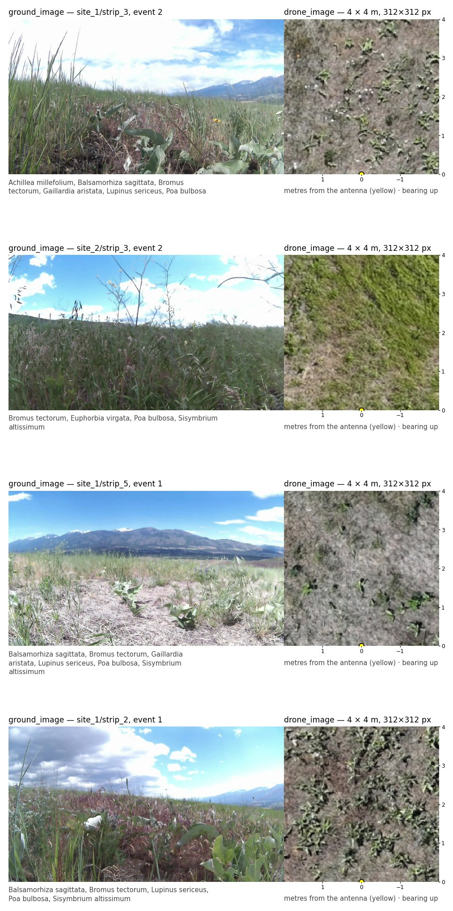
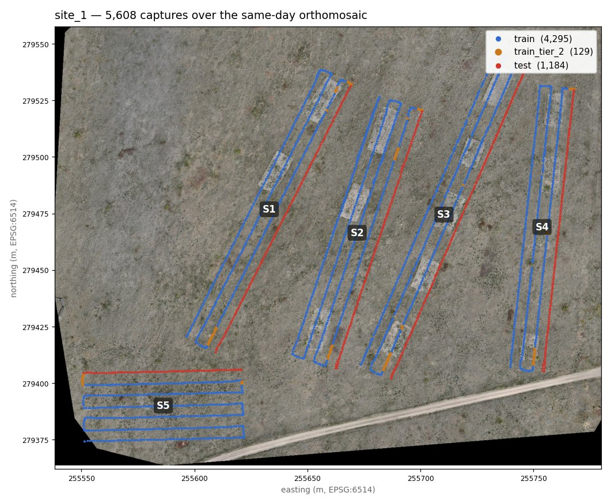
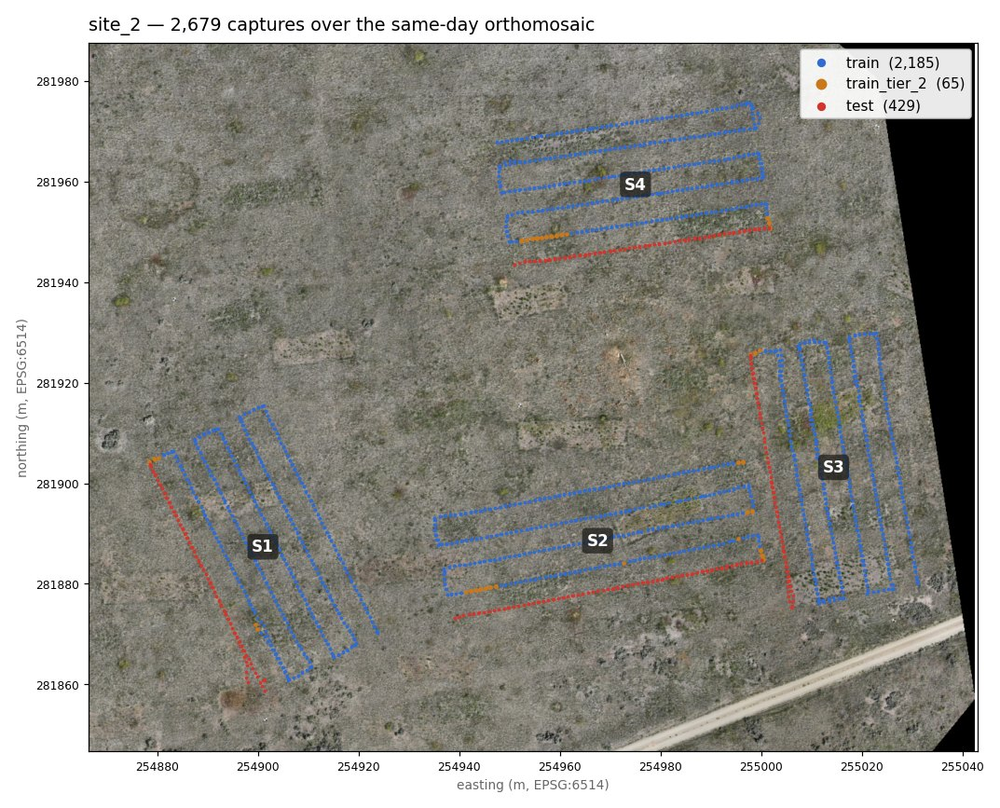
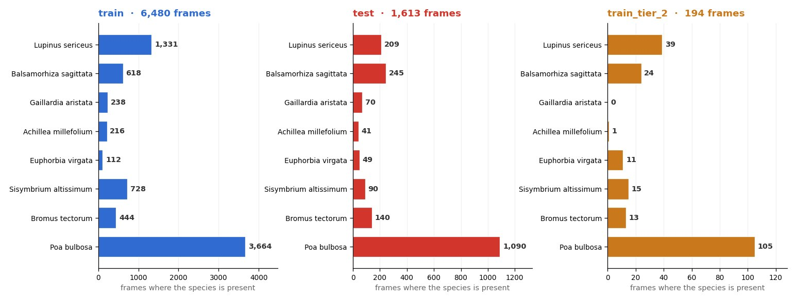
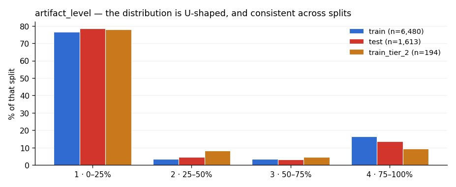

# MPG Ranch multimodal survey: robot config

Can seeing a plant from the ground *and* from the air improve automated species
identification? Paired ground-level and overhead imagery of Montana grassland,
hand-labeled for 8 plant species, built to answer that question.

**8,287** labeled ground images · **8** target species · **2** sites, 9 strips ·
**1.4 cm** RTK accuracy · **1.30 cm** drone GSD · **33** columns



Thirty five consecutive capture positions along one leg. The ground image is
on the left. Its paired 4 m by 4 m drone image is on the right, rotated so the
robot's bearing points up, with the antenna position in yellow and a 1 m scale
bar.

## 1. Contents and motivation

Identifying plant species from photographs is hard from any single vantage
point. A camera at ground level sees leaf shape, flower color, and growth
habit, but stems overlap and distant plants shrink to a few pixels. A camera
looking straight down sees the spatial arrangement of vegetation clearly, but
flattens the very structure that distinguishes one species from another. Each
view holds information the other lacks. This dataset exists to test whether
combining them improves species classification over either alone. A
four-legged robot walked lawnmower patterns of parallel legs, nine strips in
all, across two grassland sites at MPG Ranch in western Montana, photographing
the vegetation ahead of it every meter, with each capture position surveyed to
centimeter accuracy. A drone photographed the same ground from above, usually
within a few hours of the capture event and always within a day, and its
imagery was stitched into a seamless overhead map. Every row of the dataset
pairs one ground image with the 4 × 4 m drone image of the ground directly in
front of the robot at that moment. A botanist reviewed every one of the 8,287
ground images for the presence of eight target species (four native
wildflowers and four invasive weeds) and, in a separate pass, graded each
image's quality. Each strip was covered twice, from the ground and the air
alike, so the same vegetation appears under two different sets of field
conditions.

### Features

| Feature | Type | Notes |
|---|---|---|
| **Identity & imagery** | | |
| `frame_id` | string | Capture stem, the join key and the source file name |
| `ground_image` | Image | The robot's camera view as a 1280×720 JPEG, near-horizontal, wide-angle |
| `drone_image` | Image | The paired nadir drone image, 308×308 px at exactly 1.30 cm per pixel, cropped from the flight's orthomosaic with the row's RTK antenna position at its bottom-edge midpoint and the bearing pointing up. Each pixel is interpolated once, bilinearly, from the orthomosaic at its native pixel size. The orthomosaics were rectified against surveyed ground-control points at both sites, so drone image placement and robot positions share a common geodetic frame |
| **Labels** | | |
| `species` | Sequence(ClassLabel) | Which of the 8 target species are present. Variable length 0 to 6. Empty means reviewed and none present |
| `artifact_level` | ClassLabel(4) | Share of the ground image degraded by video decoder artifacts, in four quartile levels numbered 0 to 3 (`0-25%`, `25-50%`, `50-75%`, `75-100%`) |
| **Where** | | |
| `site` | string | `site_1` or `site_2` |
| `strip` | string | `strip_1` … `strip_5` within a site |
| `latitude` | float64 | WGS84 latitude of the **GNSS antenna**, interpolated to the shutter instant. The camera and the imaged ground both lie forward of this point |
| `longitude` | float64 | WGS84 longitude of the **GNSS antenna**, same basis as `latitude` |
| `altitude_ellipsoidal_m` | float64 | Ellipsoidal height of the **GNSS antenna**, 1178 to 1200 m. The antenna rides above the ground surface |
| `accuracy_horizontal_m` | float64 | Receiver-reported, 1.4 to 1.7 cm. Trustworthy where `fix_type` is 6 |
| `accuracy_vertical_m` | float64 | 1.0 to 1.7 cm, same caveat |
| `fix_type` | int8 | GNSS solution state at the shutter, 6 (RTK fixed) on 8,285 ground images and 5 (RTK float) on 2. The two float rows report the same centimeter accuracy, which is optimistic. This column is the honest flag |
| `pdop` | float64 | Position dilution of precision, 0.88 to 1.25 across the release |
| `satellites_used` | int8 | Satellites in the solution, 23 to 32 |
| `bearing_deg` | float64 | Post-processed from the RTK track. Matches the image's EXIF `GPSImgDirection` |
| `footprint_wkt` | string | The 4 × 4 m footprint on the ground as a WKT polygon in WGS84 lon/lat, corners ordered antenna-left, antenna-right, front-right, front-left. This is the square the split rule and the overlap columns use. The drone image's 308 pixel grid at 1.30 cm spans 4.004 m, 4 mm past the footprint's far and side edges. For map overlay and spatial joins. Re-cropping the image itself needs no geometry (section 2) |
| **When** | | |
| `ground_captured_at` | string | Shutter instant of the ground image, ISO 8601 with offset |
| `drone_captured_at` | string | The median source-photograph timestamp of the flight that produced this row's `drone_image`, from the PPK camera log. The mosaic is a composite, so its center-of-mass in time stands in for an instant. Flights ran 5.5 to 19.6 min |
| `capture_offset_absolute` | float64 | Hours from `drone_captured_at` to `ground_captured_at`, signed. Positive means the ground image came after the flight median. Median 1.16 h, max 20.29 h |
| `capture_offset_time_of_day` | float64 | The same offset with the date discarded, the clock-time difference only, wrapped to ±12 h. Median 1.16 h, max 4.35 h |
| `capture_event` | int8 | Capture event ordinal per (site, strip), 1 or 2. See the caveat below |
| `mission_restart_utc` | string, nullable | Set only on the 31 ground images captured after a 17.7 h mid-run resume, and null elsewhere |
| **Cross-event pair** | | |
| `pair_frame_id` | string, nullable | `frame_id` of the ground image at the same (leg, mark) in the strip's other capture event, and null on the 153 rows whose mark was walked only once |
| `pair_distance_m` | float64, nullable | Antenna separation between the paired capture positions, median 0.10 m, 95th percentile 0.33 m, max 2.12 m |
| `pair_overlap_fraction` | float64, nullable | Share of this row's footprint covered by the paired row's footprint |
| `pair_offset_hours` | float64, nullable | Time between the paired captures, 3.0 to 3.4 h at `site_2` and 48 to 71 h at `site_1` |
| **Along the strip** | | |
| `leg` | string | `leg01` to `leg13`. Odd legs are the straight lines of the strip, even legs the turns between them |
| `along_leg_m` | float64 | Nominal position along the leg, 0 to 150 m, counted from the leg's start waypoint on every row (the 31 rows after the mid-run resume included). The capture position lies a median 19.4 cm from its planned mark (95th percentile 40.2 cm, maximum 2.45 m). Use lat/lon when precision matters |
| `frame_offset_s` | float64 | Shutter offset from the intended 1 m mark, the only per-row record of timing jitter |
| `speed_mps` | float64 | 0 to 1.46 m/s |
| **Provenance & split** | | |
| `run_id` | string | e.g. `strip_3_2026-06-16_11-29-48`. Links a row back to the source repository's `missions/` tree |
| `tier2_overlap_fraction` | float64, nullable | Share of this row's footprint shared with test footprints. Populated on `train_tier_2` rows only |

### The two capture events

Every strip was walked twice, and each capture event is paired with its own
drone flight. No two capture events see the same conditions. Even at the same
clock time, illumination, cloud, wind, and plant posture all differ. The two
capture events are best read as **two independent condition samples** of the
same ground rather than a controlled contrast. The interval between them
differs by site, and the repeat is spatial rather than exact.

| Site | Interval between the two capture events | Character |
|---|---|---|
| `site_2` | 3.0 to 3.4 h, same day | Morning and afternoon capture events of the same strip, a within-day contrast |
| `site_1` | 48 to 71 h | A second capture event two to three days later. Strips 1 and 5 were re-walked at nearly the same time of day |

The robot follows the same nominal 1 m grid in both capture events, but it
does not land in the same place twice. Matching `leg` and mark across the two
capture events, the antenna positions differ by the amounts below.

| Separation at the same (leg, mark) | Value |
|---|---|
| median | 10.1 cm |
| 75th percentile | 14.9 cm |
| 95th percentile | 32.6 cm |
| 99th percentile | 65.6 cm |
| maximum | 2.12 m |
| within 10 cm | 49.0% |
| within 25 cm | 91.6% |
| within 50 cm | 97.9% |
| within 1 m | 99.8% |

A (leg, mark) pair therefore marks the same neighborhood revisited rather than
a fixed quadrat. 4,067 marks appear in both capture events. The remaining 153
appear in only one, where a ground image was skipped in one capture event. Per
strip the medians run 6.8 to 14.9 cm and the worst single case is 2.12 m on
`site_2/strip_1`. That is close enough to treat the pair as the same patch of
vegetation and too loose to treat it as a fixed plot. The pairing is recorded
on every row. `pair_frame_id` identifies the counterpart ground image, and
`pair_distance_m`, `pair_overlap_fraction`, and `pair_offset_hours` quantify
the separation.

### The flights

| Flight | Paired with | Source photographs per sensor | Duration | Median capture (UTC) | GCP RMSE (horizontal) | GSD |
|---|---|---|---|---|---|---|
| 260616-site-1-am | `site_1` event 1 | 295 | 19.6 min | 18:02:05 | 3.29 cm | 1.30 cm |
| 260617-site-2-am | `site_2` event 1 | 154 | 5.5 min | 17:04:07 | 3.22 cm | 1.30 cm |
| 260617-site-2-pm | `site_2` event 2 | 147 | 5.5 min | 20:23:59 | 1.94 cm | 1.30 cm |
| 260618-site-1-pm | `site_1` event 2 | 265 | 9.9 min | 20:33:34 | 1.78 cm | 1.30 cm |

All four flights flew the same plan, with identical extents per site, 9 m
photo spacing, and matching altitude. The first flight of the campaign ran at
2.2 m/s, half the 4.4 m/s of the other three, which is the whole story behind
its longer duration. Photo spacing and overlap are unaffected. Timestamps come
from the PPK camera logs (GPS time corrected for leap seconds). Five
ground-control targets per site, at the four corners and the center, anchored
the orthomosaic rectification. Each flight's DroneDeploy processing report
located all five, and GCP RMSE is the horizontal RMS residual computed from
the per-point X and Y errors in that report. GSD is the sensor's ground sample
distance at the flight altitude, and every drone image is gridded at exactly
that pitch. The delivered site 1 orthomosaics are gridded at 1.30 cm per pixel
and the site 2 orthomosaics at 1.28 cm, and the build interpolates each drone
image pixel once, bilinearly, from the native raster.

## 2. Paired examples

The left column shows the ground image. The right column shows the drone
image for the same row, rotated so the robot's bearing points up, with the
antenna at the bottom-edge midpoint (yellow).



The nadir view is mostly bare ground with discrete plants. The robot's oblique
view foreshortens the same scene into apparently continuous cover. Both are
accurate. A ground-level camera simply stacks many meters of vegetation into a
few degrees of elevation.

> **The drone image is its own coordinate system.** Rows are meters ahead of
> the antenna, columns are meters to the side, and one pixel is exactly
> 1.30 cm (308 pixels span 4.004 m), so any smaller or repositioned window is
> plain array slicing with no projection or rotation math (code in section 5).
> The `footprint_wkt` column places the 4 m footprint on a map for GIS work.
> Image work never needs it.

## 3. Splits

The split follows a single rule. **The test split is an outermost leg of every
strip**, `leg01` in eight of the nine strips and `leg13` in `site_1/strip_5`,
a choice made before the strip's western terminus was recovered in the
orthomosaics, and the published split is retained. The assignment was made on
geometry, never on the labels. Every other row is a training candidate.
Because both capture events walk the same legs, the split groups them
automatically, so the same ground never straddles the train/test boundary.

| Split | Rows | Share | Definition |
|---|---|---|---|
| `train` | 6,480 | 78.2% | Zero drone image overlap with any test row |
| `test` | 1,613 | 19.5% | The outermost leg of all 9 strips, both capture events |
| `train_tier_2` | 194 | 2.3% | Its drone image intersects a test drone image. Inclusion is optional |




Every capture position, colored by split, over the site's own orthomosaic.
The red test legs sit on the outside of each strip. The orange tier-2 rows hug
them. At site 1, S5's test leg is on its eastern side rather than its western
one. At site 2, S3's test leg runs alongside S2. The strips abut, which is
where the cross-strip overlaps come from.

### Why `train_tier_2` exists

Adjacent legs are 4.1 to 5.3 m apart, and a 4 m drone image reaches 2.0 m
laterally, and further once the bearing wanders off the leg axis. So a small
number of training drone images cover ground that also appears in a test
drone image. Rather than delete them, they are labeled and set aside.

| Leg | Rows | Why it lands in tier 2 |
|---|---|---|
| `leg03` | 126 | The leg adjacent to a `leg01` test leg |
| `leg02` | 44 | The turn joining `leg01` to `leg03`, whose ground comes within 0.21 m of the test leg. Only 42% of the 106 turn rows qualify. The rest stay in clean train |
| `leg12`, `leg10` | 16 | `site_1/strip_5`: the neighbors of its `leg13` test leg |
| `leg05`, `leg09` | 8 | `site_2/strip_2`. Its legs run alongside `strip_3`'s test leg where the two strips abut |

> **The zero-overlap guarantee applies to the drone images only.** The ground
> camera is oblique and wide-angle. A train ground image on `leg03` shows
> test-leg terrain 5 m away in essentially every case, at distance and
> foreshortened. That ground-modality leakage is inherent to the survey
> geometry and is not quantified. The guarantee is limited to the aerial
> modality. No drone image in `train` shares any ground with a test drone
> image.

> **Training on `train` alone is exactly clean in the aerial modality**,
> verified by polygon intersection over every pair of footprints rather than a
> distance heuristic. Adding `train_tier_2` puts 2.50% of the evaluated pixels
> on ground the model has seen, touching 213 of the 1,613 test drone images.
> `tier2_overlap_fraction` supports partial inclusion. The median is 4.5% and
> the maximum 62.6%, so a threshold recovers most of those rows while leaving
> the worst behind. This matters most for *Euphorbia virgata*, the rarest
> class, which has 11 of its 123 training positives in tier 2.

## 4. Labels

Eight target species, four wildflowers and four weeds, labeled by presence in
the ground image. Labels were assigned from a blank slate, with nothing
pre-checked and no model predictions shown, by a **single annotator per task**
(one for species, one for `artifact_level`). No inter-annotator agreement data
exists. A ground image with an empty list was reviewed and had no target
present (23% of ground images).



| Species | Common name | Group | train | test | tier 2 | total | of all ground images |
|---|---|---|---|---|---|---|---|
| *Lupinus sericeus* | silky lupine | wildflower | 1,331 | 209 | 39 | 1,579 | 19.1% |
| *Balsamorhiza sagittata* | arrowleaf balsamroot | wildflower | 618 | 245 | 24 | 887 | 10.7% |
| *Gaillardia aristata* | blanketflower | wildflower | 238 | 70 | 0 | 308 | 3.7% |
| *Achillea millefolium* | common yarrow | wildflower | 216 | 41 | 1 | 258 | 3.1% |
| *Euphorbia virgata* | leafy spurge | weed | 112 | 49 | 11 | 172 | 2.1% |
| *Sisymbrium altissimum* | tall tumblemustard | weed | 728 | 90 | 15 | 833 | 10.1% |
| *Bromus tectorum* | cheatgrass | weed | 444 | 140 | 13 | 597 | 7.2% |
| *Poa bulbosa* | bulbous bluegrass | weed | 3,664 | 1,090 | 105 | 4,859 | 58.6% |

> **The class balance is steep.** *Poa bulbosa* appears in 58.6% of ground
> images and *Euphorbia virgata* in 2.1%, a 28× spread. Ground images carry 0
> to 6 species at once (median 1), which is why `species` is a variable-length
> list rather than a fixed multi-hot vector.

A machine-readable species table ships beside the data as
[`species.csv`](species.csv) (genus, species, common name).

### Image quality

A second annotation pass graded every ground image for the share degraded by
video decoder artifacts, in four quartile levels numbered 0 to 3 (0-25%,
25-50%, 50-75%, and 75-100% of the image). The robot delivers its camera feed
as an H.264 stream over WebRTC, and packets lost on the wireless link leave the
decoder to conceal the missing data with content from earlier video frames,
which produces blocky or smeared regions. The distribution is U-shaped rather
than graded.



> **The robot's own corruption flag is uninformative here.** Every ground
> image reports `corrupt = false`, including all 1,304 a human graded at
> level 3 (75-100% degraded). To select clean imagery, filter on
> `artifact_level`.

### Suggested metric

Report the average precision per species, the area under its one-against-all
precision-recall curve, plus the macro average over the eight species. With
the class balance above, a single pooled number hides exactly the classes
this dataset is hardest on, and average precision needs no decision
threshold.

```python
import numpy as np
from sklearn.metrics import average_precision_score

# y_true: (n_rows, 8) binary array in the canonical class order
# y_score: (n_rows, 8) predicted scores or probabilities, same order
per_species = average_precision_score(y_true, y_score, average=None)
macro = average_precision_score(y_true, y_score, average="macro")
for name, ap in zip(CLASSES, per_species):
    print(f"{name:24s} {ap:.3f}")
print(f"{'macro average':24s} {macro:.3f}")
```

Use the provided splits as-is so results stay comparable.

## 5. Loading the dataset

### Basic

```python
# pip install datasets
from datasets import load_dataset

# the clean training split: 6,480 ground images, zero test overlap in the drone images
train = load_dataset("mpg-ranch/multimodal-survey", split="train")
test  = load_dataset("mpg-ranch/multimodal-survey", split="test")

row = train[0]
row["ground_image"]  # PIL.Image, 1280x720: the ground image
row["drone_image"]   # PIL.Image, 308x308: the 4 m nadir drone image, bearing up
row["species"]       # [0, 7]  (class ids, see the multi-hot snippet below)
row["artifact_level"]# 0  (level 0: 0-25% of the ground image degraded)
```

### Species labels to a multi-hot vector

```python
import numpy as np

CLASSES = train.features["species"].feature.names   # canonical order, 8 classes

def multi_hot(batch):
    v = np.zeros((len(batch["species"]), len(CLASSES)), dtype=np.int8)
    for i, ids in enumerate(batch["species"]):
        v[i, ids] = 1                               # species are stored as class ids
    return {"labels": v}

train = train.map(multi_hot, batched=True)
```

### Filtering

```python
# drop the heavily degraded ground images (level 3)
LEVELS = train.features["artifact_level"].names
clean = train.filter(lambda r: r["artifact_level"] != LEVELS.index("75-100%"))

# ground images captured close in time to their drone imagery
tight = train.filter(lambda r: abs(r["capture_offset_time_of_day"]) < 1.0)

# one site, one capture event
morning = train.filter(lambda r: r["site"] == "site_2" and r["capture_event"] == 1)

# rows where a particular species is present
spurge = train.filter(lambda r: CLASSES.index("Euphorbia virgata") in r["species"])
```

### Including tier 2

```python
# all 194 of them: accepts 2.50% evaluated-pixel contamination
t2 = load_dataset("mpg-ranch/multimodal-survey", split="train_tier_2")

# or only the mildly-overlapping ones, e.g. under 10% of the drone image shared
t2_mild = t2.filter(lambda r: r["tier2_overlap_fraction"] < 0.10)

from datasets import concatenate_datasets
train_plus = concatenate_datasets([train, t2_mild])
```

### Using the pair

```python
import torch
from torchvision.transforms.functional import to_tensor

def collate(batch):
    # the ground image is oblique and wide-angle. The drone image is nadir and metric.
    # They cover overlapping ground but are NOT pixel-registered to each other.
    robot = torch.stack([to_tensor(b["ground_image"].resize((640, 360))) for b in batch])
    drone = torch.stack([to_tensor(b["drone_image"]) for b in batch])   # 3x308x308
    y     = torch.tensor(np.stack([b["labels"] for b in batch]), dtype=torch.float32)
    return robot, drone, y

loader = torch.utils.data.DataLoader(train, batch_size=32, collate_fn=collate)
```

### Re-cropping the drone image

```python
# the drone image is a metric chart: rows are meters ahead of the antenna, columns meters left.
# A smaller or shifted window is array slicing. No projection knowledge is needed.
N, P = 308, 0.0130                              # pixels per side, meters per pixel
PX = 1 / P                                      # 76.9 px per meter

def sub_crop(drone_image, ahead, left, size):
    # (ahead, left): window center in meters from the antenna
    a = np.asarray(drone_image)
    r = round(N - (ahead + size / 2) * PX)      # row 0 is 4.004 m ahead
    c = round(N / 2 - (left + size / 2) * PX)   # column 0 is 2.002 m left
    return a[r : r + round(size * PX), c : c + round(size * PX)]

patch = sub_crop(row["drone_image"], ahead=1.0, left=0.0, size=2.0)  # 2 x 2 m, 154 x 154 px
```

### Recovering the geometry

```python
# each drone image spans 0 to 4.004 m ahead of the antenna and 2.002 m to either side,
# rotated so `bearing_deg` points up the image. To place a drone image pixel on the ground:
import math

def pixel_to_ground(row, px, py, P=0.0130, N=308):
    th = math.radians(row["bearing_deg"])
    fwd = (N - py - 0.5) * P                 # meters ahead of the antenna
    lat = (N / 2 - px - 0.5) * P             # meters to the left
    dE  = fwd * math.sin(th) - lat * math.cos(th)
    dN  = fwd * math.cos(th) + lat * math.sin(th)
    return dE, dN                            # offset in meters, EPSG:6514
```

## 6. Prior work

Several lines of research connect overhead and ground-level views for organism
classification, but only the first below fuses the two as joint classifier
input. The others use one view to supervise, label, or direct the other.
Releases that combine aerial and ground platforms serve SLAM, registration,
navigation, and crop phenotyping. To our knowledge none pairs ground-robot
photographs with coincident centimeter-scale drone images cropped from
orthomosaics over the same footprints, labeled for plant species in natural
vegetation. The closest neighbors follow.

### The Auto Arborist Dataset (CVPR 2022)

Beery et al. ([paper](https://openaccess.thecvf.com/content/CVPR2022/html/Beery_The_Auto_Arborist_Dataset_A_Large-Scale_Benchmark_for_Multiview_Urban_CVPR_2022_paper.html)). Pairs aerial and street-level imagery of more than two million urban trees
across 23 North American cities for genus-level classification, with baselines
for each view alone and for the two combined. It was assembled by joining the
cities' public tree censuses to Street View and overhead imagery, and its
central experiment is geographic generalization. Models are evaluated in
cities held out of training.

### TaxaBind (WACV 2025)

Sastry et al. ([paper](https://arxiv.org/abs/2411.00683)). Learns a joint embedding over six modalities, using ground-level species
photos as the anchor that binds satellite imagery, location, text, audio, and
environmental features, and evaluates it on zero-shot species classification.
The core technique, multimodal patching, distills each pairwise alignment into
the shared ground-image encoder without erasing the ones learned before it,
trained on 2.7 million satellite-to-species-photo pairs.

### WildSAT (ICCV 2025)

Daroya et al. ([paper](https://arxiv.org/abs/2412.14428)). Trains satellite-image encoders by contrasting them against millions of
geotagged citizen-science wildlife observations and habitat descriptions,
transferring ground-level signal into the overhead view. Its contribution is
the training signal itself: a contrastive objective linking a satellite patch
to the species recorded there and to Wikipedia habitat text, which beats both
ImageNet and satellite-specific pretraining on downstream recognition tasks.

### GeoLifeCLEF (annual benchmark)

Picek et al. ([2024 overview](https://hal.inrae.fr/hal-04720817v1)). Predicts plant species composition at ground-observation sites from satellite
imagery and environmental rasters, linking the overhead view to species
recorded in person at the same coordinates. Recent editions pair roughly five
million occurrence records and 100,000 standardized survey plots across Europe
with Sentinel-2 patches, Landsat time series, and climate and soil rasters,
scored as multi-label species composition prediction.

### Aerial-ground robotics for precision farming (IEEE RAM 2021)

Pretto et al. ([paper](https://arxiv.org/abs/1911.03098)). The EU Flourish project teamed a survey drone with an intervention ground
robot, classifying crops and weeds from both platforms over the same field,
the closest operational precedent for the drone-plus-robot pairing here. The
demonstrated loop runs from a multispectral drone survey to a weed map
co-registered into the ground robot's frame, which the robot then acts on
plant by plant with targeted spraying or mechanical stamping.

### MuST-C (Scientific Data 2026)

Chong et al. ([paper](https://www.nature.com/articles/s41597-025-06462-y)).
Releases ground-robot photographs and drone orthophotos at millimeter GSD of
the same crop plots across a season, co-registered through shared GNSS
georeferencing, the closest dataset precedent to the pairing here. The trial
is a monoculture experiment where species are known by design, annotations
are plant traits rather than species labels, and no per-footprint image pairs
are curated.

### Outdoor robot imagery datasets (RUGD, RELLIS-3D, GOOSE)

A ground-robot lineage releases outdoor imagery for semantic segmentation.
RUGD ([Wigness et al.](https://doi.org/10.1109/IROS40897.2019.8968283)) and
RELLIS-3D ([Jiang et al.](https://github.com/unmannedlab/RELLIS-3D))
established the off-road benchmark line, GOOSE
([Mortimer et al.](https://goose-dataset.de/)) carries the finest current
ontology at 64 classes, and its GOOSE-Ex extension adds the only annotated
quadruped-mounted imagery to date, with vegetation appearing throughout as
coarse structural classes such as grass, bush, and tree, never as botanical
species.

### DeepWeeds (Scientific Reports 2019)

Olsen et al. ([paper](https://www.nature.com/articles/s41598-018-38343-3)).
Releases 17,509 ground-level images of eight named weed species across
Australian rangeland, the nearest ecosystem and label-type match to this
dataset. Capture used a fixed camera rig at robot height rather than a robot
in motion, labels are image-level, and no aerial imagery is paired.

## Citation and license

Data are released under CC BY 4.0. Code in the source repository
([mosscoder/multimodal_survey](https://github.com/mosscoder/multimodal_survey))
is MIT. See [`CITATION.cff`](CITATION.cff) in this repository for the
preferred citation. The build is reproducible from the source repository by
running `python -m multimodal_dataset build` at commit `SOURCE_COMMIT`.
